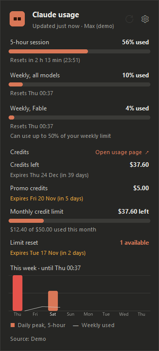
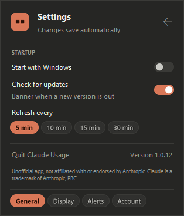
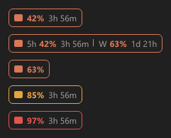

<p align="center">
  
</p>

<h1 align="center">Claude Usage</h1>

<p align="center">See how much of your Claude limits you've used, right next to the Windows clock.</p>

---

Claude Usage is a small, free Windows app for people on a Claude plan (Pro, Max, Team). It sits in the taskbar next to the clock and shows how much of your **5-hour limit** you've used and how long until it resets. Click it for the full picture: weekly limits, per-model limits such as Fable, your credit balance, limit resets you can still use, and a chart of this week's usage.

It warns you before you run out (at 20%, 10% and 5% left) and tells you when a limit has reset, so you know when you can continue.

> **Unofficial.** This project is not affiliated with, endorsed by, or supported by Anthropic. Claude is a trademark of Anthropic, PBC.

> **Vibe coded.** This app was built mostly by prompting an AI coding assistant, then tested by hand.

## Screenshots

<table>
  <tr>
    <td align="center"><b>Usage window</b></td>
    <td align="center"><b>Settings</b></td>
  </tr>
  <tr>
    <td valign="top"></td>
    <td valign="top"></td>
  </tr>
</table>

**Next to the clock.** The widget can show the 5-hour limit, the weekly limit, or both, with the time left until each resets. It turns amber when 20% or less is left and red at 5% or less.



## Features

- **5-hour and weekly limits** with progress bars and reset times. Per-model weekly limits (for example Fable) appear automatically when your plan has them, and disappear when it doesn't.
- **Credits:** your credit balance and when it expires, plus your monthly credit limit when usage credits are on.
- **Resets & extras:** limit resets you can use, such as "Full reset · 1 available · Expires Wed 10 Dec 23:00".
- **This week:** daily peak of the 5-hour limit and how your weekly usage grew.
- **Notifications:** before you run out, when a limit resets, and when something new to use shows up.
- **Light on the servers:** it asks for new numbers at most every 5 minutes, also across restarts.

## Settings

Open them with the gear icon in the usage window, or right-click the widget → **Settings**. Changes save automatically.

**General**

| Setting | What it does |
|---|---|
| Start with Windows | Starts Claude Usage when you sign in to Windows. |
| Show usage next to the clock | Shows or hides the widget in the taskbar. |
| Show in the taskbar widget | **5-hour**, **Weekly**, **Time left** (until each resets), plus the colored **Square** and **Outline**. |
| Number in the tray icon | **Off** (just the logo), **5-hour** or **Weekly**. |
| Refresh every | 5, 10, 15 or 30 minutes. |

**Notifications**

| Setting | What it does |
|---|---|
| Alert when this much is left | **20%**, **10%**, **5%**. Each alert comes once per limit, and again only after that limit resets. |
| Include weekly limits | Also alert for weekly and per-model limits. |
| Alert when a limit resets | One switch per limit type (5-hour, Weekly, and per-model ones like Fable), e.g. "Your weekly limit has reset". |

**Data source**

| Setting | What it does |
|---|---|
| Auto / Claude Code / claude.ai | Where usage is read from. **Auto** uses your Claude Code login and falls back to claude.ai. |
| Renew Claude Code login | Renews the Claude Code login when it has expired, so the numbers keep updating. |
| claude.ai: Log in | Opens claude.ai in a small window. After you sign in, credits and limit resets are shown too. **Log out** removes the login. You can also paste the `sessionKey` cookie yourself. |

## Install

Download `ClaudeUsage-<version>.exe` from the [latest release](../../releases/latest) and run it. There's nothing to install; turn on **Start with Windows** in Settings to have it start automatically.

The exe isn't code-signed, so Windows SmartScreen or Smart App Control may warn about it or block it the first time.

Only one copy runs at a time. If it's already running, starting it again tells you so.

## Run from source

```
pip install --user -r requirements.txt
pythonw claude_usage.pyw
```

`python claude_usage.pyw --demo` shows fake data so you can try out the UI.

## Build the exe

```
pip install --user pyinstaller
python build.py
```

The version comes from `__version__` at the top of `claude_usage.pyw`; bump it before building. The exe is written to `build/<version>/ClaudeUsage-<version>.exe`, with that version in its file properties and on the Settings page.

**Releases:** bump `__version__`, commit and push to `main`. GitHub then builds the exe, tags the commit `v<version>` and publishes it as a release (see `.github/workflows/release.yml`). Pushes that don't change `__version__` don't create a release.

## Privacy

Everything stays on your PC. Settings, history and your claude.ai login (if you use it) are stored in `%APPDATA%\ClaudeUsage`. If you use your Claude Code login, the app reads `~/.claude/.credentials.json`; when it renews an expired login it writes the new one back to that file, after making a one-time backup (`.credentials.json.bak-claudeusage`).

## License

MIT, see [LICENSE](LICENSE).
